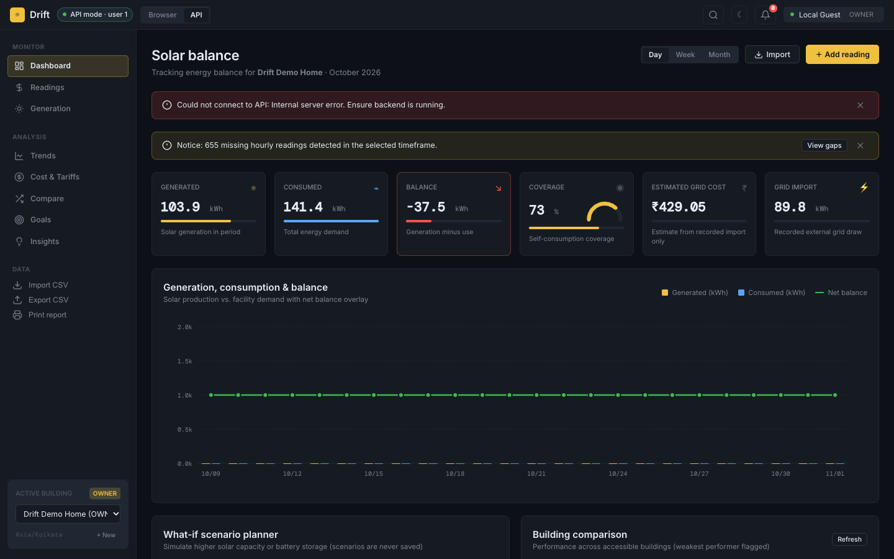
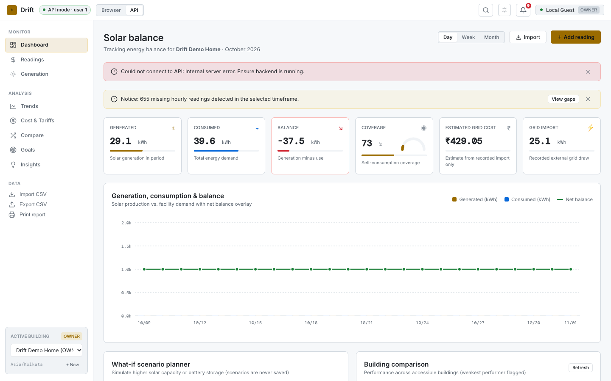
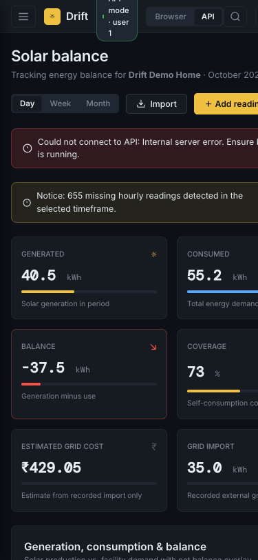
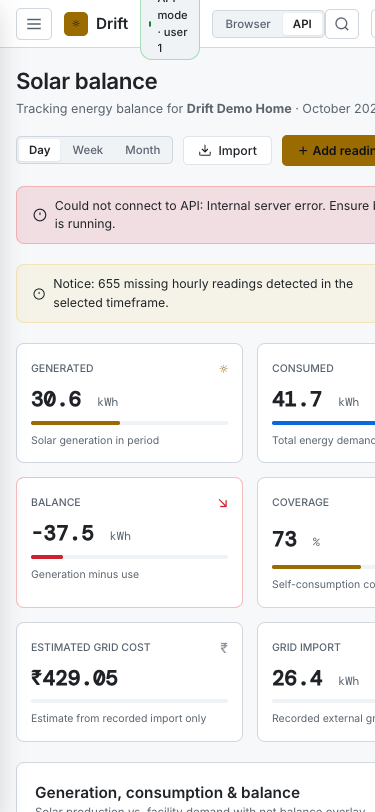

# Drift — Solar Balance Monitor

Drift is a solar balance monitor for homes and commercial buildings. It continuously compares clean energy generated with energy consumed over identical intervals, tracking net surplus/deficit, solar self-consumption coverage, telemetry gaps, and grid import costs over time.

Built with an **Express 5.1** REST API, **Prisma 6.19 ORM**, and **PostgreSQL 18**, with a zero-dependency **vanilla JavaScript ES-module dashboard** in `frontend/`.

---

## Visual Showcase



| Dark Theme (Desktop) | Light Theme (Desktop) |
|---|---|
|  |  |

| Dark Theme (Mobile 375px) | Light Theme (Mobile 375px) |
|---|---|
|  |  |

---

## Key Features

- **Dark-First Product Design**: Precision dark mode (`#0d1117`) and high-contrast light theme (`#f6f8fa`) with instant toggle persisted in `localStorage` and `prefers-color-scheme` support.
- **Sticky Topbar & Collapsible Sidebar**: 48px sticky header with brand mark, Browser/API mode switch, notification center, and user identity chip; 220px sidebar collapsing into an off-canvas drawer on mobile (`<= 800px`) with zero horizontal page scroll at 375px.
- **High-Density Stat Cards**: Generated, Consumed, Balance, Solar Coverage (with dynamic semicircle dial gauge), Estimated Grid Cost, and Grid Import with animated number count-ups and progress bars.
- **Zero-Dependency Vector Chart**: Combined generation & consumption bars with net balance overlay line, axis units, and interactive index hover tooltips.
- **Peak-Hours Heatmap**: 7x24 grid visualizing hourly energy balance with tooltips, accessible color scale, and pattern markers for colorblind users.
- **Building Goals & Projections**: Target solar coverage % and monthly surplus target with automatic on-track / at-risk projections.
- **Multi-Building Comparison**: Cross-site comparison table with 7-day sparklines and automatic flagging of the weakest performer.
- **Tiered Tariff Calculator**: User-editable slab calculator (units from/to, rate per kWh) plus flat-rate alternative, clearly labeled as an editable example.
- **Readings Table with Server-Side Pagination**: Server-side pagination, search, date-range filtering, and column sorting, staying fast on a full year of hourly telemetry (8,760 rows).
- **CSV Export & Import**: Export with custom date-range picker and column chooser; atomic batch import with row-level validation feedback.
- **Rule-Based Insights**: Peak solar generation window, maximum deficit interval, telemetry gap analysis, and CO₂ avoided estimate (using India CEA baseline factor 0.716 kg CO₂/kWh).
- **Battery Storage What-If**: Scenario slider testing battery capacity (kWh) to calculate avoided grid draw without altering stored data.
- **Command Palette (Ctrl/Cmd+K)**: Quick building switcher, section navigation, theme toggle, and shortcuts help.
- **Printable Weekly Report**: 1-page clean report using print stylesheet (`@media print`).
- **Interactive API Documentation**: Live `/docs` endpoint documenting every route, parameter, example payload, and role requirement.

---

## Architecture & Documentation

- [`docs/AUDIT.md`](docs/AUDIT.md): Comprehensive Phase 0 audit of bugs, accessibility gaps, contrast ratios, and security boundaries.
- [`docs/CHANGES.md`](docs/CHANGES.md): Full engineering changelog, what changed, how to run, measured vs. estimated breakdown, and limitations.
- [`docs/api.md`](docs/api.md): REST API specification and formula references.
- [`dbms/`](dbms/): Normalization report, ER diagram, PostgreSQL schema, example queries, and timing plans.
- [`dbms/05_query_timings.md`](dbms/05_query_timings.md): Real measured query timings on PostgreSQL 18.7 with 8,760 hourly records.

---

## Quickstart

### 1. Browser-Only Preview Mode (No Database Needed)

Preview mode runs entirely in the browser with local storage:

```sh
cd frontend
python3 -m http.server 8080
```

Open `http://localhost:8080`. Click **"⚡ Load demo data"** to load a realistic weather-varied 7-day solar curve.

### 2. Full API Mode (PostgreSQL + Express)

Requirements: Node.js 20+ and PostgreSQL 15+.

```sh
# 1. Setup environment
cp .env.example .env
# Edit DATABASE_URL in .env to match your local PostgreSQL database

# 2. Install dependencies & initialize database
npm install
npm run prisma:generate
npm run prisma:migrate:deploy
npm run db:seed

# 3. Run test suite (13 automated tests)
npm test

# 4. Start the application
npm run dev
```

Open `http://localhost:3000/?mode=api&userId=1` (Demo User, Owner) or `userId=2` (Priya Mehta, Editor/Viewer).  
Open `http://localhost:3000/docs` to view the interactive API reference.

### 3. Run DBMS Benchmark Queries

In a dedicated database:

```sh
createdb drift_dbms
psql -v ON_ERROR_STOP=1 -d drift_dbms -f dbms/03_schema.sql -f dbms/seed.sql
```

Real execution times and query plan buffers are saved in `dbms/plans/` and documented in [`dbms/05_query_timings.md`](dbms/05_query_timings.md).

---

## Security & Access Control

- **Tenant Isolation**: Role-based access control (OWNER, EDITOR, VIEWER) is enforced in PostgreSQL queries and HTTP middleware. Viewers are strictly read-only.
- **Input Validation**: All parameters and payloads are validated using Zod.
- **Identity Header**: `X-User-Id` is a development identity mechanism for this academic project, not production auth.
